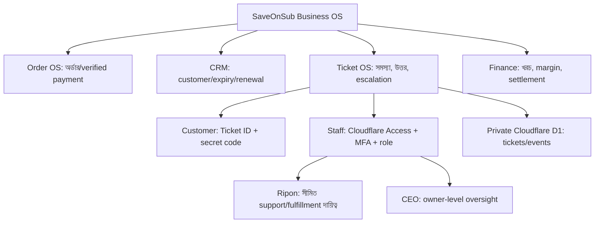
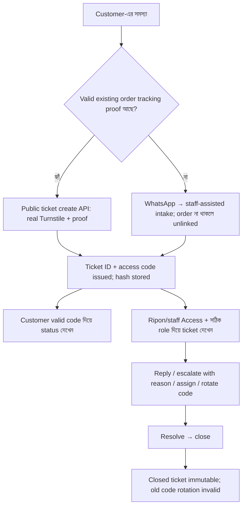

# SaveOnSub Ticket OS — CEO-এর সহজ Mind Map, বাস্তব পরীক্ষা ও Release Checklist

**তারিখ:** ১৪ নভেম্বর ২০২৬ (Asia/Dhaka)  
**অবস্থা:** Cloudflare staff-staging-এ CEO-র দেওয়া রিপোর্ট অনুযায়ী synthetic ticket lifecycle টেস্ট সফল; production নয়।  
**প্রমাণের ধরন:** CEO-র সরবরাহ করা staging-test summary; এই checkpoint-এ raw HTTP/D1 logs স্বাধীনভাবে পড়া হয়নি।  
**মূল প্রমাণ:** `STAGING-EVIDENCE-2026-11-14.md`, `ACTIVATION-RUNBOOK-2026-11-14.md`, PR #163/#164/#170; QA CI সফল, কিন্তু real security acceptance অসম্পূর্ণ।

## ১. এক বাক্যে

Ticket = কাস্টমারের সমস্যার আলাদা কেস নম্বর। Customer শুধু নিজের Ticket ID + access code দিয়ে অবস্থা দেখবেন; Ripon/authorized staff Cloudflare Access দিয়ে কাজ করবেন; CEO oversight রাখবেন। টিকিটের সাফল্য **ক্রয়, পেমেন্ট, অ্যাক্টিভেশন বা মুনাফা যাচাইয়ের প্রমাণ নয়**।

## ২. সহজ Mind Map

## ৩. আসল customer flow (এখনো public launch নয়)

**দুটি আলাদা দরজা:** customer public path এবং staff private path। Staff login সফল হওয়া = customer public path সফল হওয়া নয়। Customer path-এ কোনো সবার জন্য উন্মুক্ত staff API হবে না।

## ৪. টেস্ট — CEO-র দেওয়া বাস্তব staging report

| Case | রিপোর্ট অনুযায়ী ফল | প্রমাণের অবস্থা |
| --- | --- | --- |
| ভুল ইনপুট | HTTP 400 | CEO-REPORTED PASS |
| অজানা order | HTTP 404; 0 write | CEO-REPORTED PASS |
| ticket create | access code issued, displayed once | CEO-REPORTED PASS |
| valid code দিয়ে status | HTTP 200 | CEO-REPORTED PASS |
| ভুল/নেই code | একই 404 | CEO-REPORTED PASS |
| escalation | কারণ বাধ্যতামূলক | CEO-REPORTED PASS |
| code rotate | নতুন code কার্যকর | CEO-REPORTED PASS; old-code rejection-এর real log দরকার |
| অজানা operator assign | HTTP 404 | CEO-REPORTED PASS |
| closed ticket edit | HTTP 409 | CEO-REPORTED PASS |

**Test ticket:** staging D1-তে বন্ধ অবস্থায় রেখে দেওয়া হয়েছে বলে CEO জানিয়েছেন। এটি কখনো বাস্তব গ্রাহকের order/finance রিপোর্টে গণনা করা যাবে না।  
**Access code:** একবার *দেখানো* হয়, কিন্তু একবার ব্যবহার করেই শেষ হয় না; rotate করলে পুরোনো code বাতিল হয়।  
**Real-test proof gap:** endpoint/method, redacted request-response, exact staging SHA/deployment, D1 audit/no-write counters এবং timestamp যুক্ত করা দরকার। কোনো raw access token, OTP, JWT, PIN বা secret evidence-এ রাখা যাবে না।

## ৫. কাজের অবস্থা (pass ≠ production)

| অংশ | বর্তমান অবস্থা | Production gate |
| --- | --- | --- |
| Staff UI ও owner Access | আগে UI read দেখা হয়েছে; real synthetic test CEO-REPORTED PASS | MFA + staff allowlist independent proof |
| Ticket validation / issue / status / close | CEO-REPORTED PASS | sanitized logs + full role checks |
| Wrong-code 404 / closed 409 | CEO-REPORTED PASS | edge anti-guess rate limit ও external test |
| Ripon-এর নিজের login + RBAC denial | NOT VERIFIED | Support role payment/finance/other orders reject |
| Turnstile + server Siteverify | NOT VERIFIED | Real secret, valid/invalid/expired and fail-closed |
| Order-linked proof | NOT VERIFIED | Actual synthetic order ↔ tracking ↔ support ticket |
| Public customer endpoint | NOT ENABLED / NOT VERIFIED | Narrow Access Bypass with token + Turnstile protection |
| Cross-origin browser CORS | NOT VERIFIED | PR #170 exact build staged and preflight tested |
| Edge rate limits | NOT VERIFIED | Create/status endpoints block abuse with observed 429 |
| Staging D1 migration inventory + backup | NOT VERIFIED | Actual schema, integrity, safe rollback |
| Storefront source vs Cloudflare SHA | NOT VERIFIED | Exact release identity / preview / rollback |
| Real payments / customers / renewals | OUT OF SCOPE | Separate owner-verified settlement + consent |

## ৬. কে কী করতে পারবেন

- **Customer:** শুধুমাত্র নিজের ticket-এর status/reply; অন্যের ticket, staff পরিচয় বা finance নয়। Order না থাকলে WhatsApp-এ staff-assisted ticket হতে পারে, কিন্তু সেটিকে paid order বলা যাবে না।
- **Ripon:** CEO-approved role-এর প্রয়োজনীয় ticket handle করতে পারবেন। Support role দিয়ে payment verify, refund/finance view, arbitrary order modification, arbitrary assignment নয়; নিজস্ব login ও negative tests বাধ্যতামূলক।
- **CEO:** staff role review, payment evidence/finance approval, release consent ও compliance oversight। প্রত্যেক role change audit event হওয়া উচিত।
- **Engineering/Claude:** code, tests, PR, staging test guide, source/evidence review। CEO-র exact permission ছাড়া prod deploy, DNS, policy bypass, paid spend, customer outreach/PII import নয়।

## ৭. বাকি কাজগুলোর নিরাপদ ক্রম

1. **Evidence closure:** redacted real staging HTTP/D1 proof + precise deployed SHA, environment, previous/after row count. Test ticket অপরিবর্তিত রাখুন।
2. **D1 safety:** actual bound D1 inventory ও migration ledger, export backup এবং staging restore test; non-idempotent ALTER কখনো আন্দাজে rerun নয়।
3. **Access roles:** CEO, Ripon ও unauthorized third user দিয়ে MFA + positive/negative role matrix (Ripon-এর আলাদা account)।
4. **Turnstile:** Cloudflare-এর real staging sitekey + secret; secret শুধু Cloudflare secret storage-তে; server Siteverify valid, absent, invalid, expired, replay failure।
5. **Customer boundary:** staff endpoints private; প্রয়োজনীয় customer endpoints-এর জন্য *path-specific*, minimally scoped Bypass + code validation, no PII. Bypass পুরো host-এর জন্য নয়। Browser origin `saveonsub.com` থেকে CORS/OPTIONS test।
6. **Abuse controls:** `/api/support/tickets` ও `/api/support/tickets/status` rate limits; 429, retry, enumeration resistance ও logs QA।
7. **Order link:** synthetic order + tracking proof + ticket create/view/assign/escalate/rotate/close + immutable audit; real customer/payment data ব্যবহার নয়।
8. **Privacy & support:** consent, retention/deletion policy, code lost/reissue SOP, service-hours/fallback, notification, monitoring, accessibility/mobile, backup/rollback।
9. **Controlled release:** PR #163 → #164 → #170 dependency, #172 tracking-contract compatibility এবং #171 customer receipt copy পৃথকভাবে review; exact SHA approval, staging E2E, production release ID + rollback plan। **কোনো auto-deploy নয়।**

## ৮. CEO Decision

**Core ticket lifecycle: CEO-REPORTED STAGING PASS**  
**Customer public readiness: NO-GO**  
**Business OS full commercial readiness: NO-GO**

Customer ticket API-কে বাহ্যিকভাবে পৌঁছানো যায় এমন করতে হবে কেবল যথাযথ নিরাপত্তা ও approval সম্পন্ন হলে। "No gap" মানে অজানা কাজ গোপন করা নয়; প্রতিটি কাজের Evidence, Owner, Acceptance Test এবং Release Gate দৃশ্যমান রাখা।
